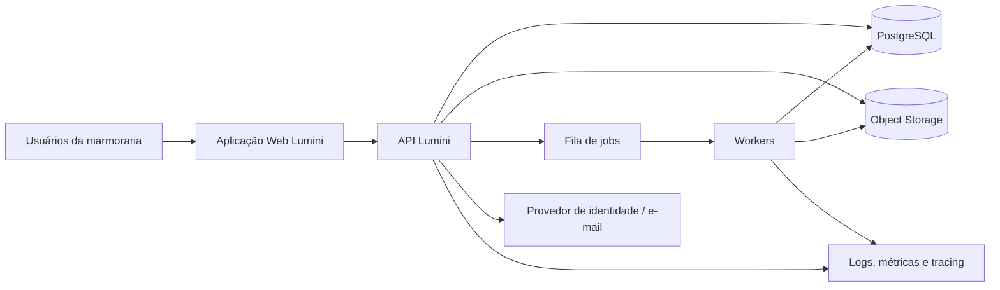
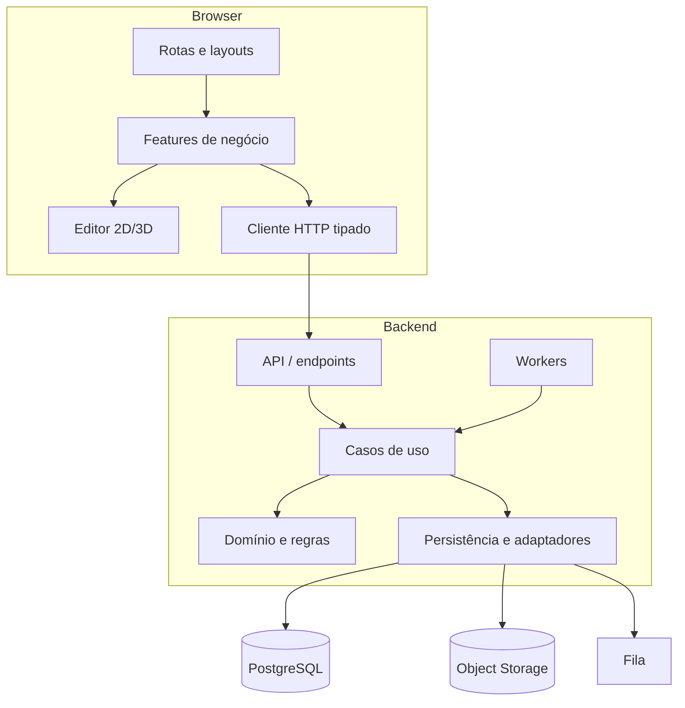

# 2. Arquitetura, tecnologias e estrutura do repositório

## 2.1 Decisão arquitetural

**Decisão proposta:** monólito modular no backend, com camadas inspiradas em Clean Architecture/Ports and Adapters e workers para operações pesadas.

Motivos:
- reduz custo e complexidade de operação no início;
- mantém transações simples para orçamento, estoque e revisões;
- separa domínios por contratos;
- permite extrair processamento de corte/importação se houver evidência de necessidade.

Não iniciar com microserviços sem requisito de escala, equipe ou isolamento operacional que justifique essa decisão.

## 2.2 Diagrama de contexto C4



Usuários acessam apenas a aplicação web. A API aplica autenticação, autorização e regras de negócio. O navegador não acessa o banco diretamente. Arquivos são enviados por fluxo controlado ou URLs assinadas de curta duração; metadados e permissões continuam sendo validados pela API.

## 2.3 Containers e componentes



## 2.4 Stack proposta

| Camada | Escolha proposta | Responsabilidade / ressalva |
|---|---|---|
| Web | React + TypeScript + Vite | Aplicação autenticada; SSR não é requisito central |
| UI | Tailwind CSS + shadcn/ui + Radix | Design system consistente e acessível |
| Estado remoto | TanStack Query | Cache, retry controlado, invalidação e sincronização |
| Formulários | React Hook Form + Zod | Validação e mensagens de campo |
| Estado local | React state; Zustand opcional | Não duplicar cache do servidor; Redux não é necessário por padrão |
| 2D | SVG/Canvas ou Konva após prova técnica | Separar geometria e renderer; medir desempenho antes de escolher |
| 3D | Three.js + React Three Fiber | Visualização e inspeção, não fonte única de dimensões |
| Backend | C# + ASP.NET Core Web API | API REST e regras de aplicação |
| ORM | EF Core + Npgsql | Persistência e migrations; SQL explícito em consultas críticas quando necessário |
| Banco | PostgreSQL | Relacional, transações, constraints, índices e RLS adicional |
| Identidade | ASP.NET Core Identity ou OIDC gerenciado | Decisão depende de orçamento, MFA, SSO e responsabilidade operacional |
| Arquivos | Object storage compatível com S3 | DXF, IFC, imagens, PDFs e snapshots |
| Jobs | Fila gerenciada ou Redis + worker/Hangfire | Escolher conforme hospedagem; job idempotente e monitorável |
| Contratos | OpenAPI + cliente TypeScript gerado | Reduz divergência API/frontend |
| Testes | xUnit, PostgreSQL de teste, Vitest, Playwright | Unidade, integração e E2E |
| Observabilidade | OpenTelemetry + logs estruturados | Correlation ID, métricas e tracing |
| Infraestrutura | Docker + CI/CD | Ambientes reproduzíveis |

As versões exatas devem ser validadas no momento da implementação conforme suporte vigente e dependências do repositório. Não atualizar dependências principais sem CI e testes.

## 2.5 Camadas backend

- **API/Presentation:** rotas, autenticação, autorização, binding, DTOs, status HTTP.
- **Application:** casos de uso, orquestração, transações, idempotência e criação de jobs.
- **Domain:** entidades, value objects, invariantes, estados e cálculos determinísticos.
- **Infrastructure:** EF Core, PostgreSQL, object storage, fila, e-mail e serviços externos.
- **Workers:** tarefas demoradas com validação do estado e do tenant; não confiar cegamente no payload da fila.

Dependências apontam para o domínio; o domínio não depende de HTTP, ORM ou componentes de UI.

## 2.6 Estrutura de diretórios proposta

```text
lumini/
├── apps/
│   ├── web/
│   │   └── src/
│   │       ├── app/                  # providers, router, bootstrap
│   │       ├── routes/               # composição de páginas por rota
│   │       ├── features/
│   │       │   ├── auth/
│   │       │   ├── organization/
│   │       │   ├── clients/
│   │       │   ├── projects/
│   │       │   ├── drawing/
│   │       │   ├── pricing/
│   │       │   ├── cutting/
│   │       │   ├── inventory/
│   │       │   ├── documents/
│   │       │   ├── users/
│   │       │   └── audit/
│   │       ├── components/            # UI compartilhada
│   │       ├── editor2d/              # geometria, snapping, cotas, transformações
│   │       ├── editor3d/              # cena, câmera, materiais, visualização
│   │       ├── api/                   # cliente HTTP, contratos, tratamento de erros
│   │       ├── hooks/
│   │       ├── stores/
│   │       ├── styles/
│   │       └── utils/
│   └── api/
│       ├── Lumini.Api/
│       ├── Lumini.Application/
│       ├── Lumini.Domain/
│       ├── Lumini.Infrastructure/
│       ├── Lumini.Workers/
│       ├── Lumini.Contracts/
│       └── tests/
│           ├── Lumini.UnitTests/
│           ├── Lumini.IntegrationTests/
│           └── Lumini.ArchitectureTests/
├── packages/
│   ├── geometry-core/                 # tipos/algoritmos puros, se necessário
│   ├── api-client/                    # cliente OpenAPI gerado
│   └── design-tokens/
├── docs/
│   ├── adr/
│   ├── diagrams/
│   ├── runbooks/
│   ├── security/
│   └── product/
├── infra/
├── scripts/
├── .github/workflows/
├── AGENTS.md
└── README.md
```

**Regra de migração:** se o repositório atual não for monorepo, não reorganizar tudo de uma vez. Manter o que funciona e migrar por fatias, com build verde após cada etapa.

## 2.7 Convenções

- Nomes de domínio claros; evitar `Manager`, `Helper` e `Utils` sem responsabilidade específica.
- DTOs terminam em `Request`/`Response`; entidades de domínio não são retornadas diretamente.
- Cada caso de uso tem entrada, saída e política de autorização explícitas.
- Cada módulo possui testes e documentação de endpoints.
- Sem acesso direto a banco a partir do frontend.
- Sem segredo em código, `.env` versionado ou logs.
- Arquivos gerados e uploads não devem ser guardados dentro do banco como blobs por padrão.
- Cada decisão relevante fica registrada em `docs/adr/`.

## 2.8 ADRs iniciais

**ADR-001 — Monólito modular:** escolhido para reduzir custo e manter transações simples; reavaliar com métricas reais.  
**ADR-002 — PostgreSQL:** escolhido para integridade relacional e consultas de negócio; usar JSONB apenas para metadados flexíveis, não para substituir relações centrais.  
**ADR-003 — Geometria separada do renderer:** geometria canônica em milímetros; renderers 2D/3D consomem o mesmo modelo.  
**ADR-004 — Jobs para tarefas longas:** importação, otimização e PDFs podem demorar; retornar `202 Accepted` e `job_id`.  
**ADR-005 — Revisões imutáveis:** documentos e orçamentos referenciam revisões identificáveis; mudanças não sobrescrevem silenciosamente a base aprovada.
