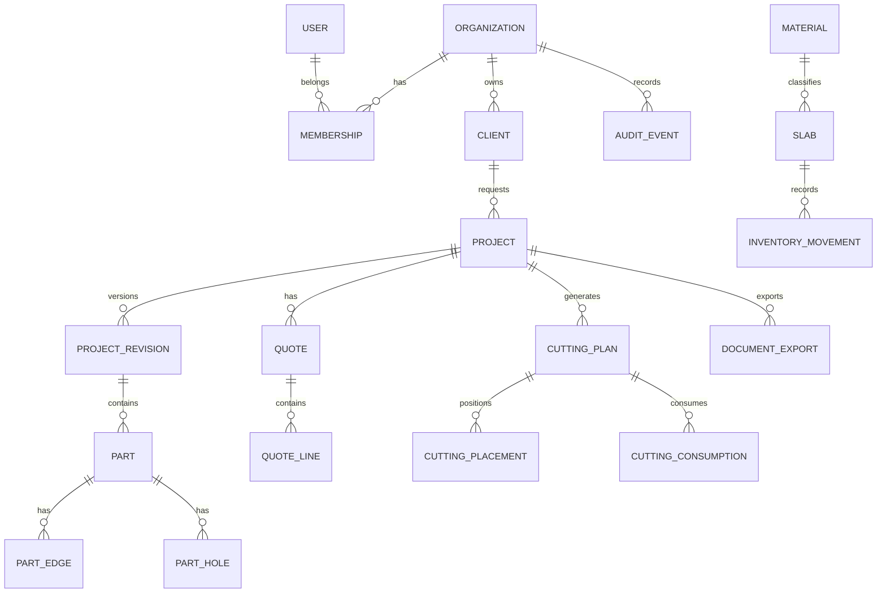

# 5. Banco de dados, entidades e persistência

## 5.1 Escolha

**PostgreSQL** é a base transacional recomendada. O domínio tem relações fortes entre empresa, projeto, revisão, peça, orçamento, estoque e plano de corte. Integridade referencial e transações são mais importantes do que adotar banco documental por tendência.

Arquivos binários grandes (DXF, IFC, imagens e PDFs) ficam em object storage; PostgreSQL guarda metadados, hash, tamanho, tipo, tenant, referência e política de retenção.

## 5.2 Convenções

- PK preferencialmente UUID; IDs públicos não precisam expor sequências.
- `tenant_id` em toda tabela de negócio tenant-scoped.
- `created_at`, `updated_at` em UTC; `created_by`, `updated_by` quando útil.
- Dinheiro em `numeric(precision, scale)` e regra explícita de arredondamento.
- Dimensões em `numeric` com escala definida, unidade canônica mm.
- Estado por enum controlado ou tabela de referência conforme necessidade de evolução.
- FK e constraints no banco além da validação de aplicação.
- Índices começam por tenant e campos de filtro frequentes, confirmados com `EXPLAIN ANALYZE`.
- Soft delete só quando há necessidade de recuperação/auditoria; não usar em tudo automaticamente.
- Revisões aprovadas são imutáveis; mudanças criam nova revisão.
- `jsonb` somente para configurações/metadados que variam; não armazenar entidades relacionais centrais como JSON genérico.

## 5.3 Modelo lógico simplificado

## 5.4 Tabelas essenciais

### Identidade e organização

| Tabela | Campos principais | Restrições/índices |
|---|---|---|
| `users` | `id`, `email_normalized`, `display_name`, `status`, timestamps | e-mail normalizado único globalmente se a política de identidade for global |
| `organizations` | `id`, `name`, `slug`, `status`, `settings_jsonb` | slug único conforme escopo definido |
| `memberships` | `id`, `tenant_id`, `user_id`, `status`, `joined_at` | unique (`tenant_id`,`user_id`) |
| `roles` | `id`, `tenant_id` nullable para papéis de sistema, `name` | unique por tenant/nome |
| `permissions` | `code`, `description` | `code` único |
| `role_permissions` | `role_id`, `permission_code` | unique composta |
| `membership_roles` | `membership_id`, `role_id` | unique composta |
| `invitations` | `id`, `tenant_id`, `email`, `token_hash`, `expires_at`, `accepted_at` | token hash único; expiração validada |

### Clientes e projetos

| Tabela | Campos principais | Restrições/índices |
|---|---|---|
| `clients` | `id`, `tenant_id`, `name`, `phone`, `email`, `notes`, `status` | índice tenant + nome; dados pessoais minimizados |
| `projects` | `id`, `tenant_id`, `client_id`, `code`, `name`, `status`, `owner_user_id`, `current_revision_id`, `version` | unique tenant + code; FK composta/escopo validado |
| `project_revisions` | `id`, `tenant_id`, `project_id`, `revision_number`, `status`, `geometry_schema_version`, `snapshot_jsonb`, `created_by`, `created_at` | unique project + revision_number; snapshots publicados imutáveis |
| `project_attachments` | `id`, `tenant_id`, `project_id`, `object_key`, `file_name`, `mime_type`, `size_bytes`, `sha256` | índice tenant + project; objeto protegido por autorização |

### Desenho e geometria

| Tabela | Campos principais | Restrições/índices |
|---|---|---|
| `parts` | `id`, `tenant_id`, `revision_id`, `part_code`, `name`, `material_id`, `thickness_mm`, `geometry_jsonb`, `sort_order` | unique revision + part_code; dimensão válida |
| `part_edges` | `id`, `tenant_id`, `part_id`, `edge_code`, `edge_index`, `finish_type`, `length_mm`, `pricing_rule_id` | unique part + edge_code |
| `part_holes` | `id`, `tenant_id`, `part_id`, `hole_code`, `center_x_mm`, `center_y_mm`, `diameter_mm`, `kind` | diâmetro positivo; centro dentro da geometria conforme regra |
| `drawing_annotations` | `id`, `tenant_id`, `revision_id`, `kind`, `position_jsonb`, `content`, `style_jsonb`, `target_part_id` | validação do tipo e referência |
| `drawing_groups` | `id`, `tenant_id`, `revision_id`, `name`, `transform_jsonb` | grupo vinculado a uma revisão |
| `drawing_group_members` | `group_id`, `element_type`, `element_id` | integridade validada pela aplicação; considerar modelo relacional por tipo |

A geometria deve ser versionada por schema. Para formas complexas, definir serialização determinística, validação e limites de tamanho. Se geometria crescer muito, avaliar normalização seletiva após medir consultas e atualizações.

### Materiais, acabamentos e preços

| Tabela | Campos principais | Restrições/índices |
|---|---|---|
| `materials` | `id`, `tenant_id`, `name`, `brand`, `color_code`, `thickness_options`, `active` | nome pesquisável por tenant |
| `finish_types` | `id`, `tenant_id`, `code`, `name`, `description`, `active` | code único por tenant |
| `pricing_tables` | `id`, `tenant_id`, `name`, `version`, `valid_from`, `valid_to`, `status` | versão única por tenant |
| `pricing_rules` | `id`, `tenant_id`, `table_id`, `kind`, `unit`, `rate`, `conditions_jsonb` | validação de unidade e moeda |
| `quotes` | `id`, `tenant_id`, `project_id`, `project_revision_id`, `pricing_table_id`, `status`, `currency`, `subtotal`, `discount`, `tax`, `total`, `version` | referência explícita à revisão e tabela |
| `quote_lines` | `id`, `tenant_id`, `quote_id`, `source_type`, `source_id`, `description_snapshot`, `quantity`, `unit`, `unit_price`, `total` | snapshot de descrição/preço para rastreabilidade |

### Corte e estoque

| Tabela | Campos principais | Restrições/índices |
|---|---|---|
| `slabs` | `id`, `tenant_id`, `material_id`, `thickness_mm`, `width_mm`, `height_mm`, `batch_code`, `location`, `status`, `source_slab_id` | dimensões positivas; status válido |
| `inventory_movements` | `id`, `tenant_id`, `slab_id`, `movement_type`, `quantity_or_area`, `reference_type`, `reference_id`, `created_by`, `created_at` | movimento imutável; índice slab + data |
| `cutting_jobs` | `id`, `tenant_id`, `project_id`, `project_revision_id`, `status`, `algorithm_version`, `constraints_jsonb`, `job_id` | idempotency key; estado controlado |
| `cutting_plans` | `id`, `tenant_id`, `cutting_job_id`, `status`, `utilization`, `waste_area`, `approved_by`, `approved_at` | aprovação exige resultado válido |
| `cutting_placements` | `id`, `tenant_id`, `plan_id`, `part_id`, `slab_id`, `x_mm`, `y_mm`, `rotation_deg`, `mirrored`, `validation_status` | uma peça não pode ser colocada duas vezes no mesmo plano sem regra explícita |
| `cutting_consumptions` | `id`, `tenant_id`, `plan_id`, `slab_id`, `area_consumed`, `remnant_created_id` | transação de consumo e criação de sobra |

### Documentos, jobs e auditoria

| Tabela | Campos principais | Restrições/índices |
|---|---|---|
| `document_templates` | `id`, `tenant_id`, `name`, `version`, `template_jsonb`, `active` | versão imutável após uso, ou duplicar ao editar |
| `document_exports` | `id`, `tenant_id`, `project_id`, `revision_id`, `type`, `object_key`, `status`, `pages_jsonb`, `created_by` | job e revisão de origem registrados |
| `background_jobs` | `id`, `tenant_id`, `type`, `status`, `attempts`, `progress`, `error_code`, `started_at`, `finished_at` | índices status + created_at |
| `audit_events` | `id`, `tenant_id`, `actor_user_id`, `action`, `resource_type`, `resource_id`, `correlation_id`, `metadata_jsonb`, `created_at` | append-only para a aplicação; acesso restrito |

## 5.5 Integridade e transações

- Criar orçamento e suas linhas na mesma transação.
- Aprovar plano e reservar/consumir estoque com controle concorrente, sem saldo negativo.
- Criar sobra e registrar consumo no mesmo fluxo transacional.
- Usar controle otimista de versão para projetos e orçamentos.
- Constraint no banco para valores positivos, estados permitidos e unicidades relevantes.
- Evitar transações abertas enquanto um algoritmo de corte executa; calcular fora da transação e validar versão/estoque ao confirmar.
- Para operações que dependem de job, persistir estado `queued` e mensagem/outbox atomicamente quando necessário.

## 5.6 Concorrência

Recomendação inicial: coluna `version`/concurrency token. A API exige a versão esperada ou `If-Match`. Se a versão atual divergir, retornar `409 RESOURCE_CONFLICT` com informação segura da revisão atual. Não mesclar automaticamente geometrias sem política clara.

## 5.7 Multi-tenancy e RLS

- Toda consulta filtra por `tenant_id` derivado da membership autenticada.
- RLS no PostgreSQL pode ser defesa em profundidade, não substitui autorização de aplicação.
- Configurar contexto do tenant por transação/conexão de forma segura, considerando pooling.
- Testar consultas ORM, jobs, exportações, URLs de arquivos e endpoints de auditoria para vazamento entre tenants.
- Nunca aceitar `tenant_id` do body como prova de autorização.

## 5.8 Backup, retenção e recuperação

- Backup automático de banco e object storage, com política de retenção definida por contrato e risco.
- Criptografia e acesso mínimo às cópias.
- Teste de restauração periódico em ambiente isolado.
- Definir RPO/RTO após avaliar custo e criticidade; não prometer números sem validação.
- Documentar como recuperar banco, objetos, chaves e configuração.
- Exclusão de tenant deve ter fluxo de exportação, retenção legal e apagamento controlado de objetos, logs e backups conforme política.
