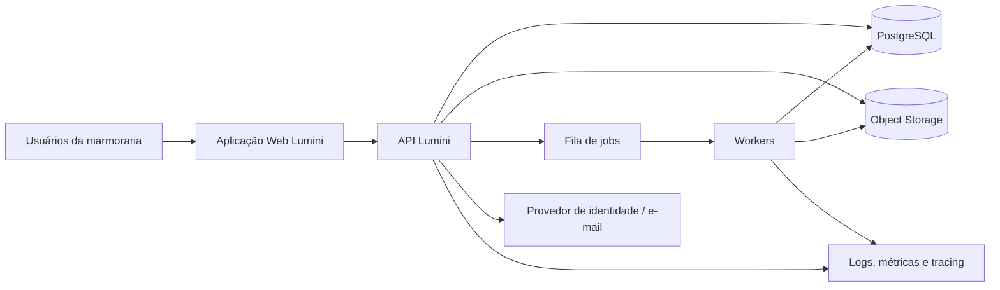
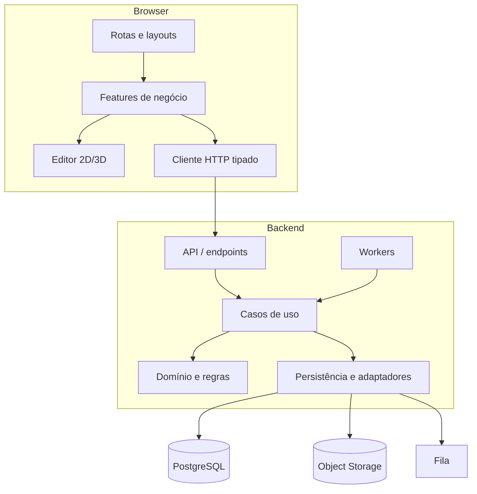
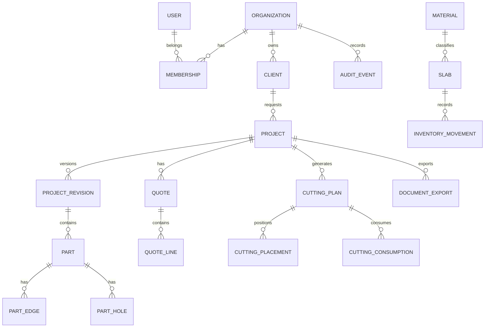

# LUMINI — Arquitetura completa e especificação do produto

**Versão:** 1.0 — proposta inicial  
**Data:** 19/10/2026  
**Status:** arquitetura-alvo a validar contra o repositório existente e com usuários de marmoraria.

> Este conjunto de documentos descreve o que deve ser construído. Não significa que todos os recursos já existam no protótipo. Preserve o código que funciona e aplique a arquitetura por etapas.

## Índice

1. [Visão do produto, escopo e requisitos](01-PRODUTO-REQUISITOS.md)
2. [Arquitetura, stack, repositório e diagramas](02-ARQUITETURA-E-STACK.md)
3. [Frontend, telas, navegação e UX](03-FRONTEND-TELAS.md)
4. [Backend, APIs, comunicação e erros](04-BACKEND-APIS-ERROS.md)
5. [Banco de dados e modelo lógico](05-BANCO-DE-DADOS.md)
6. [Identidade, RBAC, segurança e privacidade](06-SEGURANCA-RBAC.md)
7. [Domínio de desenho, corte, orçamento, estoque e PDF](07-DOMINIO-E-REGRAS.md)
8. [Qualidade, testes, observabilidade e operação](08-QUALIDADE-OPERACAO.md)
9. [Plano de implementação, riscos e checklists](09-ROADMAP-E-CHECKLISTS.md)
10. [Instruções para agentes e governança](10-AGENTS-E-GOVERNANCA.md)

## Resumo executivo

O Lumini é uma plataforma SaaS para marmorarias, conectando desenho técnico 2D/3D, peças e acabamentos, orçamento, otimização de corte, chapas e sobras de estoque e documentos de fabricação. O diferencial proposto é a **rastreabilidade ponta a ponta**: uma peça possui identidade estável e os módulos relacionados apontam para a mesma revisão do projeto.

### Arquitetura recomendada

- **Frontend:** React + TypeScript + Vite; Tailwind CSS + shadcn/ui/Radix; TanStack Query; React Hook Form + Zod.
- **Editor 2D/3D:** núcleo geométrico independente do renderer; SVG/Canvas para desenho 2D (decidir após prova técnica); Three.js + React Three Fiber para visualização 3D.
- **Backend:** C# + ASP.NET Core Web API, organizado por módulos e camadas.
- **Persistência:** PostgreSQL + EF Core/Npgsql; armazenamento de objetos S3-compatible para DXF, IFC, imagens, PDFs e snapshots.
- **Processamento demorado:** fila e workers para importação, otimização de corte, PDFs e relatórios. Não é obrigatório começar com microserviços.
- **Arquitetura:** monólito modular com limites de domínio, Clean Architecture/Ports and Adapters onde trouxer valor.
- **Segurança:** multi-tenant, RBAC no servidor, isolamento por empresa, auditoria e testes negativos.
- **Operação:** Docker, CI/CD, logs estruturados, métricas, tracing e backups testados.

### Decisões que precisam ser confirmadas

1. Estado e estrutura reais do repositório atual.
2. Algoritmo de otimização já implementado e restrições reais das máquinas.
3. Formatos DXF/IFC que serão oficialmente suportados.
4. Provedor de autenticação, nuvem e armazenamento, considerando orçamento.
5. Regras comerciais: custos, impostos, margem, comissões, arredondamento e aprovação.
6. Número de usuários, empresas e tamanho típico de projetos.
7. Se haverá edição simultânea em tempo real ou somente controle de versões.
8. Necessidade de exportação para CNC e formatos específicos de fabricantes.

## Convenções deste documento

- **Obrigatório/MVP:** necessário para uma primeira versão operacional confiável.
- **Recomendado:** forte orientação técnica, sujeita a confirmação.
- **Futuro:** não deve bloquear o MVP.
- **Hipótese:** proposta ainda não validada com o negócio.
- IDs como `RF-001`, `RN-001`, `RNF-001`, `API-001` e `TC-001` devem ser mantidos estáveis e referenciados nos testes.


---

# 1. Produto, requisitos e critérios de aceite

## 1.1 Visão

O Lumini ajuda uma marmoraria a transformar medidas, desenhos e necessidades de clientes em peças fabricáveis, orçamento rastreável, plano de corte e documentação de produção, reduzindo retrabalho e desperdício.

## 1.2 Personas

| Persona | Necessidade principal | Acesso típico |
|---|---|---|
| Proprietário/administrador | Controlar operação, pessoas, preços e indicadores | Administração da empresa |
| Projetista | Criar e revisar desenho, peças, cotas e acabamentos | Desenho e projetos |
| Orçamentista | Calcular custos, margens e propostas | Orçamento e preços autorizados |
| Operador de corte | Preparar e executar o plano de corte | Corte e documentos liberados |
| Estoquista | Controlar chapas, lotes e sobras | Estoque |
| Instalador/leitor | Consultar documentos aprovados | Somente leitura |
| Suporte Lumini | Diagnosticar problemas com acesso excepcional auditado | Acesso temporário e restrito |

## 1.3 Escopo do MVP

1. Cadastro de empresa, usuários e clientes.
2. Projetos com revisões e estados explícitos.
3. Editor 2D com medidas em milímetros, seleção, movimentação, rotação, cotas e agrupamento básico.
4. Peças com material, espessura, dimensões, furos e bordas/acabamentos iniciais.
5. Importação DXF com relatório de entidades aceitas/rejeitadas e revisão visual antes de confirmar.
6. Orçamento conectado à revisão do projeto.
7. Estoque básico de chapas e sobras.
8. Plano de corte com restrições configuráveis e validação humana antes da produção.
9. PDF técnico e comercial com seleção de páginas, cotas configuráveis, imagens e anotações.
10. Autosave, histórico de revisões e recuperação.
11. RBAC multiempresa, auditoria e testes de isolamento.
12. Observabilidade, backup, deploy e suporte operacional.

## 1.4 Fora do MVP, salvo necessidade comprovada

- Colaboração simultânea com cursores em tempo real.
- Importação IFC/BIM completa com fidelidade universal.
- Exportação CNC para qualquer máquina/controlador.
- Aplicativo móvel completo para edição geométrica.
- Otimização distribuída em vários serviços.
- IA que altera projetos ou define fabricação sem revisão humana.

## 1.5 Requisitos funcionais

| ID | Requisito | Prioridade | Critério de aceite resumido |
|---|---|---|---|
| RF-001 | Autenticar usuários | MVP | Login/logout e recuperação sem revelar se e-mail existe |
| RF-002 | Isolar empresas | MVP | Usuário de uma empresa não lê nem altera registros de outra |
| RF-003 | Gerenciar clientes | MVP | Criar, consultar, editar e arquivar conforme permissão |
| RF-004 | Criar projetos | MVP | Projeto tem empresa, cliente, responsável, status e revisão |
| RF-005 | Desenhar peças em 2D | MVP | Geometria usa unidade de domínio, não pixels |
| RF-006 | Editar dimensões e cotas | MVP | Validação de dimensão positiva e exibição de unidade |
| RF-007 | Agrupar elementos | MVP | Grupo move/edita elementos associados sem quebrar referências |
| RF-008 | Configurar furos | MVP | Entrada por diâmetro; raio derivado e consistência garantida |
| RF-009 | Definir acabamentos de borda | MVP | Cada borda pode ter acabamento, custo e observações |
| RF-010 | Importar DXF | MVP | Pré-visualização, resumo de entidades e confirmação explícita |
| RF-011 | Gerar orçamento | MVP | Valores calculados por regra versionada e revisão de projeto |
| RF-012 | Gerar plano de corte | MVP | Respeita limites configurados e exibe avisos/uso da chapa |
| RF-013 | Gerenciar chapas e sobras | MVP | Entrada, reserva, consumo e origem rastreáveis |
| RF-014 | Gerar PDF técnico | MVP | PDF mostra revisão, identificadores, cotas e acabamentos selecionados |
| RF-015 | Autosave e recuperação | MVP | Falha simulada permite recuperar última revisão persistida |
| RF-016 | Histórico de alterações | MVP | Autor, data, ação e versão são consultáveis conforme permissão |
| RF-017 | Administrar usuários e papéis | MVP | Alterações de acesso são autorizadas e auditadas |
| RF-018 | Exportar e selecionar páginas | MVP | Exportação não remove conteúdo do projeto original |
| RF-019 | Mostrar progresso de tarefas longas | MVP | Job informa queued/running/succeeded/failed e erro recuperável |
| RF-020 | Importar IFC | Futuro/validar | Formatos e entidades suportados definidos em matriz de compatibilidade |
| RF-021 | Destacar borda entre orçamento e desenho | Alta | Seleção em um módulo realça a borda correspondente no outro |
| RF-022 | Anotar imagens de fabricação | Alta | Setas/linhas/notas ficam posicionadas e editáveis no documento |
| RF-023 | Medir em 3D | Alta | Régua/medidas visualizam dimensões do modelo sem alterar a geometria |
| RF-024 | Controle de concorrência | MVP | Edição baseada em versão detecta conflito, sem sobrescrever silenciosamente |

## 1.6 Requisitos não funcionais

| ID | Requisito | Verificação proposta |
|---|---|---|
| RNF-001 | Segurança multi-tenant | Testes de acesso cruzado por ID, endpoint e arquivo |
| RNF-002 | Integridade dimensional | Testes determinísticos com tolerâncias explícitas |
| RNF-003 | Recuperação | Teste de crash, reconexão e restauração de revisão |
| RNF-004 | Desempenho | Benchmark com projeto sintético grande e metas definidas após baseline |
| RNF-005 | Observabilidade | Toda requisição tem trace/correlation ID |
| RNF-006 | Acessibilidade | Teclado, foco, contraste e mensagens não dependentes apenas de cor |
| RNF-007 | Manutenibilidade | Regras críticas no domínio, testes e decisões registradas |
| RNF-008 | Backup | Restauração ensaiada e documentada, não apenas backup agendado |
| RNF-009 | Privacidade | Minimização, retenção e acesso por finalidade |
| RNF-010 | Compatibilidade | Matriz explícita de versões e entidades DXF/IFC suportadas |

## 1.7 Regras de negócio

- **RN-001:** todo registro operacional pertence a exatamente uma empresa (`tenant_id`).
- **RN-002:** toda dimensão de domínio é armazenada em milímetros como unidade canônica; conversão ocorre na entrada/visualização.
- **RN-003:** diâmetro é a entrada preferencial para furos; raio é derivado como `diameter_mm / 2`.
- **RN-004:** arredondamento de exibição não altera a geometria armazenada.
- **RN-005:** cada projeto tem revisão monotônica e imutável para fins de rastreabilidade; alterações criam nova revisão ou rascunho controlado.
- **RN-006:** orçamento registra a revisão do projeto e a versão da tabela de preços utilizada.
- **RN-007:** plano de corte aprovado registra versão do algoritmo, restrições, chapa e conjunto de peças de entrada.
- **RN-008:** alterações após aprovação invalidam ou marcam como desatualizados os artefatos dependentes.
- **RN-009:** nenhuma otimização é considerada ordem de produção até aprovação por usuário autorizado.
- **RN-010:** uma chapa/sobra não pode ser consumida acima do saldo disponível; reserva e baixa são transacionais.
- **RN-011:** a seleção de páginas do PDF afeta somente a exportação, nunca exclui páginas do projeto.
- **RN-012:** exclusão de registros com dependências críticas deve ser arquivamento ou bloqueada; usar exclusão física apenas conforme política de retenção.
- **RN-013:** erros de concorrência não sobrescrevem mudanças silenciosamente.
- **RN-014:** cores distinguem projetos/peças, mas cada item também tem código, rótulo e legenda acessível.
- **RN-015:** toda alteração de papel, preço, aprovação, estoque ou revisão publicada gera evento de auditoria.

## 1.8 Estados principais

**Projeto:** `draft → in_review → approved → in_production → completed`; transições para `cancelled` somente conforme política.  
**Orçamento:** `draft → calculated → sent → accepted | rejected | expired`; nova revisão cria nova versão comercial.  
**Plano de corte:** `draft → calculating → ready_for_review → approved → in_production → completed`; `failed` é estado do job, não necessariamente do plano.  
**Job:** `queued → running → succeeded | failed`; cancelamento permitido somente se o worker ainda puder interromper com segurança.

## 1.9 Definição de pronto

Uma funcionalidade só está pronta quando:
- requisito e regra de negócio estão documentados;
- validação ocorre no cliente e no servidor quando apropriado;
- autorização é verificada no servidor;
- estados de carregamento, vazio, sucesso, erro e recuperação existem;
- testes positivos, negativos e de permissão foram executados;
- logs não contêm segredos nem dados desnecessários;
- documentação e contratos foram atualizados;
- o critério de aceite foi demonstrado em homologação.


---

# 2. Arquitetura, tecnologias e estrutura do repositório

## 2.1 Decisão arquitetural

**Decisão proposta:** monólito modular no backend, com camadas inspiradas em Clean Architecture/Ports and Adapters e workers para operações pesadas.

Motivos:
- reduz custo e complexidade de operação no início;
- mantém transações simples para orçamento, estoque e revisões;
- separa domínios por contratos;
- permite extrair processamento de corte/importação se houver evidência de necessidade.

Não iniciar com microserviços sem requisito de escala, equipe ou isolamento operacional que justifique essa decisão.

## 2.2 Diagrama de contexto C4



Usuários acessam apenas a aplicação web. A API aplica autenticação, autorização e regras de negócio. O navegador não acessa o banco diretamente. Arquivos são enviados por fluxo controlado ou URLs assinadas de curta duração; metadados e permissões continuam sendo validados pela API.

## 2.3 Containers e componentes



## 2.4 Stack proposta

| Camada | Escolha proposta | Responsabilidade / ressalva |
|---|---|---|
| Web | React + TypeScript + Vite | Aplicação autenticada; SSR não é requisito central |
| UI | Tailwind CSS + shadcn/ui + Radix | Design system consistente e acessível |
| Estado remoto | TanStack Query | Cache, retry controlado, invalidação e sincronização |
| Formulários | React Hook Form + Zod | Validação e mensagens de campo |
| Estado local | React state; Zustand opcional | Não duplicar cache do servidor; Redux não é necessário por padrão |
| 2D | SVG/Canvas ou Konva após prova técnica | Separar geometria e renderer; medir desempenho antes de escolher |
| 3D | Three.js + React Three Fiber | Visualização e inspeção, não fonte única de dimensões |
| Backend | C# + ASP.NET Core Web API | API REST e regras de aplicação |
| ORM | EF Core + Npgsql | Persistência e migrations; SQL explícito em consultas críticas quando necessário |
| Banco | PostgreSQL | Relacional, transações, constraints, índices e RLS adicional |
| Identidade | ASP.NET Core Identity ou OIDC gerenciado | Decisão depende de orçamento, MFA, SSO e responsabilidade operacional |
| Arquivos | Object storage compatível com S3 | DXF, IFC, imagens, PDFs e snapshots |
| Jobs | Fila gerenciada ou Redis + worker/Hangfire | Escolher conforme hospedagem; job idempotente e monitorável |
| Contratos | OpenAPI + cliente TypeScript gerado | Reduz divergência API/frontend |
| Testes | xUnit, PostgreSQL de teste, Vitest, Playwright | Unidade, integração e E2E |
| Observabilidade | OpenTelemetry + logs estruturados | Correlation ID, métricas e tracing |
| Infraestrutura | Docker + CI/CD | Ambientes reproduzíveis |

As versões exatas devem ser validadas no momento da implementação conforme suporte vigente e dependências do repositório. Não atualizar dependências principais sem CI e testes.

## 2.5 Camadas backend

- **API/Presentation:** rotas, autenticação, autorização, binding, DTOs, status HTTP.
- **Application:** casos de uso, orquestração, transações, idempotência e criação de jobs.
- **Domain:** entidades, value objects, invariantes, estados e cálculos determinísticos.
- **Infrastructure:** EF Core, PostgreSQL, object storage, fila, e-mail e serviços externos.
- **Workers:** tarefas demoradas com validação do estado e do tenant; não confiar cegamente no payload da fila.

Dependências apontam para o domínio; o domínio não depende de HTTP, ORM ou componentes de UI.

## 2.6 Estrutura de diretórios proposta

```text
lumini/
├── apps/
│   ├── web/
│   │   └── src/
│   │       ├── app/                  # providers, router, bootstrap
│   │       ├── routes/               # composição de páginas por rota
│   │       ├── features/
│   │       │   ├── auth/
│   │       │   ├── organization/
│   │       │   ├── clients/
│   │       │   ├── projects/
│   │       │   ├── drawing/
│   │       │   ├── pricing/
│   │       │   ├── cutting/
│   │       │   ├── inventory/
│   │       │   ├── documents/
│   │       │   ├── users/
│   │       │   └── audit/
│   │       ├── components/            # UI compartilhada
│   │       ├── editor2d/              # geometria, snapping, cotas, transformações
│   │       ├── editor3d/              # cena, câmera, materiais, visualização
│   │       ├── api/                   # cliente HTTP, contratos, tratamento de erros
│   │       ├── hooks/
│   │       ├── stores/
│   │       ├── styles/
│   │       └── utils/
│   └── api/
│       ├── Lumini.Api/
│       ├── Lumini.Application/
│       ├── Lumini.Domain/
│       ├── Lumini.Infrastructure/
│       ├── Lumini.Workers/
│       ├── Lumini.Contracts/
│       └── tests/
│           ├── Lumini.UnitTests/
│           ├── Lumini.IntegrationTests/
│           └── Lumini.ArchitectureTests/
├── packages/
│   ├── geometry-core/                 # tipos/algoritmos puros, se necessário
│   ├── api-client/                    # cliente OpenAPI gerado
│   └── design-tokens/
├── docs/
│   ├── adr/
│   ├── diagrams/
│   ├── runbooks/
│   ├── security/
│   └── product/
├── infra/
├── scripts/
├── .github/workflows/
├── AGENTS.md
└── README.md
```

**Regra de migração:** se o repositório atual não for monorepo, não reorganizar tudo de uma vez. Manter o que funciona e migrar por fatias, com build verde após cada etapa.

## 2.7 Convenções

- Nomes de domínio claros; evitar `Manager`, `Helper` e `Utils` sem responsabilidade específica.
- DTOs terminam em `Request`/`Response`; entidades de domínio não são retornadas diretamente.
- Cada caso de uso tem entrada, saída e política de autorização explícitas.
- Cada módulo possui testes e documentação de endpoints.
- Sem acesso direto a banco a partir do frontend.
- Sem segredo em código, `.env` versionado ou logs.
- Arquivos gerados e uploads não devem ser guardados dentro do banco como blobs por padrão.
- Cada decisão relevante fica registrada em `docs/adr/`.

## 2.8 ADRs iniciais

**ADR-001 — Monólito modular:** escolhido para reduzir custo e manter transações simples; reavaliar com métricas reais.  
**ADR-002 — PostgreSQL:** escolhido para integridade relacional e consultas de negócio; usar JSONB apenas para metadados flexíveis, não para substituir relações centrais.  
**ADR-003 — Geometria separada do renderer:** geometria canônica em milímetros; renderers 2D/3D consomem o mesmo modelo.  
**ADR-004 — Jobs para tarefas longas:** importação, otimização e PDFs podem demorar; retornar `202 Accepted` e `job_id`.  
**ADR-005 — Revisões imutáveis:** documentos e orçamentos referenciam revisões identificáveis; mudanças não sobrescrevem silenciosamente a base aprovada.


---

# 3. Frontend, navegação, editor e UX

## 3.1 Navegação principal

```text
Aplicação
├── Visão geral
├── Clientes
├── Projetos
│   └── Projeto
│       ├── Resumo
│       ├── Desenho 2D/3D
│       ├── Peças e acabamentos
│       ├── Orçamento
│       ├── Corte
│       ├── Estoque relacionado
│       ├── Documentos/PDF
│       ├── Revisões
│       └── Histórico
├── Estoque
│   ├── Chapas
│   ├── Sobras
│   ├── Movimentações
│   └── Reservas
├── Tabelas de preço
├── Relatórios
└── Configurações
    ├── Empresa
    ├── Usuários e convites
    ├── Papéis e permissões
    ├── Materiais e acabamentos
    ├── Preferências de desenho
    └── Plano e faturamento (se aplicável)
```

## 3.2 Layout do editor

- **Barra superior:** projeto, revisão, status de salvamento, undo/redo, validar, comparar revisão e exportar.
- **Barra esquerda:** selecionar, desenhar, cota, texto, furo, recorte, imagem, grupo e ferramentas de transformação.
- **Área central:** canvas 2D ou viewport 3D, grade, zoom, pan, snapping e guias.
- **Painel direito contextual:** dimensões, material, espessura, bordas, furos, acabamento e metadados do item selecionado.
- **Painel inferior/recolhível:** árvore de peças, camadas, avisos, histórico de operações e mensagens de validação.
- **Legenda acessível:** cores por projeto/material acompanhadas por código, nome ou padrão; cor não é o único indicador.

## 3.3 Telas e contratos

| ID / tela | Rota proposta | Dados / API | Permissão |
|---|---|---|---|
| UI-001 Login | `/login` | sessão/autenticação | pública |
| UI-002 Visão geral | `/app` | resumo de projetos e tarefas | `dashboard.read` |
| UI-003 Clientes | `/app/clients` | lista paginada, busca, filtros | `clients.read` |
| UI-004 Cliente | `/app/clients/:id` | detalhe, projetos vinculados | `clients.read` |
| UI-005 Projetos | `/app/projects` | status, cliente, responsável, datas | `projects.read` |
| UI-006 Projeto | `/app/projects/:id` | projeto e revisão atual | `projects.read` |
| UI-007 Editor | `/app/projects/:id/drawing` | geometria, peças, cotas, materiais | `drawing.read/edit` |
| UI-008 Orçamento | `/app/projects/:id/quote` | itens, regras, revisão e valores | `quotes.read/edit` |
| UI-009 Corte | `/app/projects/:id/cutting` | job, layout, chapa, desperdício | `cutting.read/create/approve` |
| UI-010 Estoque | `/app/inventory` | chapas, sobras e movimentos | `inventory.read` |
| UI-011 Documentos | `/app/projects/:id/documents` | PDFs, exportações e templates | `documents.read/export` |
| UI-012 Usuários | `/app/settings/users` | membros e convites | `members.manage` |
| UI-013 Papéis | `/app/settings/roles` | permissões por papel | `roles.manage` |
| UI-014 Auditoria | `/app/settings/audit` | eventos filtrados | `audit.read` |

## 3.4 Estados obrigatórios em cada tela

1. **Loading:** skeleton ou indicador contextual; não bloquear toda a aplicação sem necessidade.
2. **Empty state:** explicar o que falta e oferecer ação compatível com a permissão.
3. **Success:** feedback conciso; não depender apenas de toast que desaparece rapidamente.
4. **Validation error:** mostrar junto ao campo e preservar entradas.
5. **Permission denied:** explicar que a ação não está autorizada sem revelar detalhes internos.
6. **Network error:** permitir tentar novamente quando seguro e preservar rascunho local.
7. **Conflict:** exibir que existe revisão mais nova, oferecer comparar/recarregar/copiar alterações quando viável.
8. **Background job:** estado e progresso, horário, botão de atualizar/cancelar quando suportado.
9. **Save failure:** mostrar que alterações não foram confirmadas no servidor; nunca exibir “Salvo” antes da confirmação.

## 3.5 Estado e comunicação

- TanStack Query para estado remoto e invalidação após mutações.
- Estado local para seleção, zoom, ferramenta ativa, painel aberto e operações temporárias.
- Estado de geometria do editor separado do cache de requisições.
- Zod valida formato no cliente; servidor sempre repete validações confiáveis.
- Cancelar requests obsoletas quando trocar de projeto.
- Evitar retry automático em operações não idempotentes, como baixa de estoque ou aprovação.
- Usar `Idempotency-Key` nas operações de criação/execução que possam ser repetidas por timeout.
- Contratos TypeScript devem ser gerados ou verificados contra OpenAPI, evitando DTOs divergentes.

## 3.6 Modelo de geometria

O modelo de domínio deve ser independente de pixels e renderer. Recomenda-se armazenar coordenadas e dimensões em milímetros, com precisão decimal adequada e conversão para coordenadas de tela somente na camada de renderização.

Entidades geométricas conceituais:
- `Part`: peça fabricável.
- `Contour`: contorno externo e contornos internos.
- `Hole`: centro e diâmetro.
- `Edge`: segmento/aresta identificável e acabamento aplicado.
- `DimensionAnnotation`: anotação de cota, separada da geometria.
- `TextAnnotation`: texto editável.
- `Group`: conjunto de elementos movidos como unidade.
- `Transform`: posição, rotação e, se suportado, espelhamento controlado.
- `MaterialAssignment`: material e espessura.
- `GeometryRevision`: versão persistida do modelo.

Regras:
- zoom e escala de tela não alteram valores geométricos;
- a rotação precisa ter precisão previsível e permitir entrada numérica;
- setas de transformação não podem variar de modo que impeça controle fino;
- espelhamento deve preservar identificadores e recalcular orientações quando necessário;
- cotas podem ser movidas sem modificar a geometria;
- desfazer/refazer atua sobre comandos do modelo, não sobre pixels capturados.

## 3.7 Performance do editor

- Renderização por demanda para objetos não alterados, quando aplicável.
- Virtualizar listas e árvores extensas.
- Evitar recriar toda a cena em cada alteração pequena.
- Separar cálculo geométrico pesado do thread principal quando a prova técnica indicar necessidade.
- Medir projetos de referência com centenas e milhares de elementos antes de definir metas finais.
- Limitar arquivos de importação por tamanho, entidades e tempo de processamento.
- Exibir aviso se o documento está desatualizado em relação ao orçamento ou plano de corte.

## 3.8 Acessibilidade e responsividade

- Navegação por teclado para formulários e controles comuns.
- Atalhos do editor documentados e sem conflito com o navegador.
- Foco visível, contraste e nomes acessíveis para ícones.
- Mensagens de erro lidas por tecnologias assistivas.
- Cores com legenda e códigos de texto.
- Editor completo prioriza desktop; celular pode ter leitura, aprovação e consulta de documentos no MVP.


---

# 4. Backend, APIs, comunicação e erros

## 4.1 Fluxo de uma requisição

1. A API recebe HTTPS e cria/propaga `trace_id` e `correlation_id`.
2. Middleware valida tamanho, formato geral e autenticação.
3. Autorização verifica usuário, empresa ativa, permissão e escopo do recurso.
4. DTO de entrada é validado; não se confia em `tenant_id` enviado pelo cliente.
5. Caso de uso coordena domínio e persistência.
6. O domínio aplica invariantes e regras de negócio.
7. A infraestrutura executa transação, constraints e grava auditoria.
8. A API retorna DTO seguro e status HTTP adequado.
9. Erros inesperados são registrados com IDs correlacionáveis, sem expor stack trace ao cliente.

## 4.2 Módulos de backend

- **Identity/Organization:** usuários, organizações, memberships, convites e papéis.
- **Clients:** clientes da marmoraria.
- **Projects:** projeto, revisão, status, responsável e metadados.
- **Drawing:** peças, contornos, cotas, furos, grupos, materiais e acabamentos.
- **Imports:** upload e parsing de DXF/IFC; relatórios de compatibilidade.
- **Pricing:** tabelas de preço, regras, versões de orçamento e aprovações.
- **Cutting:** conjunto de peças, chapas elegíveis, restrições, algoritmo, resultados e aprovação.
- **Inventory:** chapas, sobras, reserva, consumo e movimentações.
- **Documents:** templates, exportações, páginas selecionadas, PDFs e anexos.
- **Audit:** eventos de negócio consultáveis e protegidos.
- **Jobs:** fila, progresso, retry, cancelamento quando possível e resultados.
- **Billing (futuro):** planos, limites e cobrança; não misturar cobrança com autorização de domínio.

## 4.3 Endpoints REST propostos

Prefixo: `/api/v1`. A tabela é uma proposta inicial, não um contrato já publicado.

| ID | Método e caminho | Objetivo | Permissão |
|---|---|---|---|
| API-001 | `GET /api/v1/me` | Perfil e empresa ativa | autenticado |
| API-002 | `GET /api/v1/clients` | Listar clientes com paginação | `clients.read` |
| API-003 | `POST /api/v1/clients` | Criar cliente | `clients.create` |
| API-004 | `GET /api/v1/projects` | Listar projetos | `projects.read` |
| API-005 | `POST /api/v1/projects` | Criar projeto | `projects.create` |
| API-006 | `GET /api/v1/projects/{id}` | Consultar projeto | `projects.read` |
| API-007 | `PATCH /api/v1/projects/{id}` | Atualizar metadados com controle de versão | `projects.edit` |
| API-008 | `POST /api/v1/projects/{id}/revisions` | Criar revisão do projeto | `drawing.edit` |
| API-009 | `GET /api/v1/projects/{id}/revisions/{revisionId}` | Ler revisão | `drawing.read` |
| API-010 | `POST /api/v1/projects/{id}/imports/dxf` | Iniciar importação DXF | `drawing.import` |
| API-011 | `GET /api/v1/jobs/{jobId}` | Consultar progresso de job | escopo do job + `jobs.read` |
| API-012 | `POST /api/v1/projects/{id}/quotes` | Calcular/criar orçamento | `quotes.create` |
| API-013 | `POST /api/v1/quotes/{id}/approve` | Aprovar orçamento | `quotes.approve` |
| API-014 | `POST /api/v1/projects/{id}/cutting-jobs` | Solicitar otimização | `cutting.create` |
| API-015 | `POST /api/v1/cutting-plans/{id}/approve` | Aprovar plano | `cutting.approve` |
| API-016 | `GET /api/v1/inventory/slabs` | Listar chapas e sobras | `inventory.read` |
| API-017 | `POST /api/v1/inventory/movements` | Registrar movimentação | `inventory.move` |
| API-018 | `POST /api/v1/projects/{id}/documents/exports` | Gerar PDF selecionado | `documents.export` |
| API-019 | `GET /api/v1/projects/{id}/audit` | Consultar histórico | `audit.read` |
| API-020 | `POST /api/v1/organizations/{id}/members/invitations` | Convidar membro | `members.manage` |

Para cada endpoint, OpenAPI deve documentar DTO, autenticação, autorização, query, códigos HTTP, erros, idempotência, efeitos colaterais e exemplos. Nenhum endpoint deve aceitar tenant como autoridade a partir do body.

## 4.4 Padrões de API

- Paginação por cursor ou página conforme volume; listas grandes não retornam sem limite.
- Filtros e ordenação usam campos permitidos em allowlist.
- Datas em ISO 8601 UTC no contrato; interface converte para fuso configurado.
- Valores monetários retornados como decimal em formato JSON consistente; nunca usar `float`/`double` para cálculo monetário.
- Dimensões têm unidade explícita no contrato ou convenção documentada; internamente milímetros.
- Versionamento por `/api/v1`; mudanças incompatíveis exigem nova versão ou migração coordenada.
- `ETag`/`If-Match` ou `version` para prevenir sobrescrita concorrente.
- `Idempotency-Key` para operações repetíveis por retry.
- Limites de tamanho e rate limit em endpoints de autenticação, importação e exportação.

## 4.5 Exemplo de requisição

```http
POST /api/v1/projects/8f.../cutting-jobs
Authorization: Bearer <token>
Content-Type: application/json
Idempotency-Key: 3f2a...
```

```json
{
  "projectRevisionId": "rev_123",
  "materialId": "mat_45",
  "stockSelection": ["slab_22", "remnant_31"],
  "constraints": {
    "kerfMm": 4,
    "edgeMarginMm": 10,
    "allowRotation": true,
    "respectVeinDirection": true
  }
}
```

A API valida que revisão, material, chapas e projeto pertencem ao tenant, que o usuário tem permissão e que as restrições estão dentro dos limites configurados. A resposta inicial é `202 Accepted` com `jobId` e URL de consulta.

## 4.6 Exemplo de sucesso assíncrono

```json
{
  "data": {
    "jobId": "job_01J...",
    "status": "queued",
    "statusUrl": "/api/v1/jobs/job_01J..."
  },
  "meta": {
    "correlationId": "corr_..."
  }
}
```

Estados de job: `queued`, `running`, `succeeded`, `failed`, `cancel_requested`, `cancelled` quando cancelamento for seguro. A resposta de status pode incluir percentual aproximado, etapa, timestamps e erro público recuperável.

## 4.7 Contrato padronizado de erro

```json
{
  "error": {
    "code": "BUSINESS_RULE_VIOLATION",
    "message": "O plano não pode ser aprovado enquanto houver peças sem material definido.",
    "details": [
      {
        "field": "parts[2].materialId",
        "code": "REQUIRED",
        "message": "Selecione um material."
      }
    ],
    "correlationId": "corr_01J..."
  }
}
```

Não devolver stack trace, SQL, caminho de arquivo, segredo, token ou dados pessoais desnecessários.

## 4.8 Taxonomia de erros

| Código | HTTP usual | Recuperável? | Ação de UI/operacional |
|---|---:|---|---|
| `VALIDATION_ERROR` | 400/422 | Sim, após corrigir | Mostrar campos e preservar entrada |
| `AUTHENTICATION_REQUIRED` | 401 | Sim, após login | Renovar sessão ou redirecionar |
| `PERMISSION_DENIED` | 403 | Não sem permissão | Explicar falta de acesso; não revelar recurso indevido |
| `RESOURCE_NOT_FOUND` | 404 | Talvez | Verificar link/escopo; evitar enumeração |
| `BUSINESS_RULE_VIOLATION` | 409/422 | Sim após corrigir estado | Mostrar regra e caminho de correção |
| `RESOURCE_CONFLICT` | 409 | Sim, com reconciliação | Comparar versão, recarregar ou mesclar |
| `RATE_LIMIT_EXCEEDED` | 429 | Sim após espera | Respeitar `Retry-After` |
| `DEPENDENCY_UNAVAILABLE` | 503 | Geralmente | Tentar novamente com backoff; mostrar status |
| `JOB_FAILED` | 200 na consulta do job ou endpoint apropriado | Depende | Mostrar etapa e erro público; permitir nova tentativa segura |
| `FILE_TYPE_UNSUPPORTED` | 422 | Não sem outro arquivo | Informar tipos/entidades aceitos |
| `FILE_TOO_LARGE` | 413 | Sim com arquivo menor | Mostrar limite permitido |
| `INTERNAL_ERROR` | 500 | Talvez | Mensagem neutra e correlation ID |

## 4.9 Retry e idempotência

- Retry com exponential backoff e jitter apenas em falhas transitórias.
- Não repetir automaticamente operações financeiras, aprovação ou baixa de estoque sem idempotência.
- Worker pode receber o mesmo job mais de uma vez; persistir estado e chave idempotente.
- Jobs com falha registram etapa, tentativas e causa interna; payload sensível não deve ser copiado para logs.
- Circuit breaker apenas quando houver dependência instável e evidência operacional.
- Timeout explícito para parser, storage, e-mail e dependências externas.

## 4.10 Eventos e comunicação

No MVP, chamadas REST síncronas para operações rápidas e jobs assíncronos para importação, otimização e geração de PDFs. Eventos internos podem comunicar `ProjectRevisionCreated`, `QuoteApproved`, `CuttingPlanApproved` e `InventoryMovementRecorded`, mas não introduzir broker distribuído apenas para trocar mensagens dentro do mesmo processo.

Se for necessário publicar eventos duráveis para workers, considerar padrão Outbox para evitar que a transação do banco confirme sem registrar o evento correspondente.


---

# 5. Banco de dados, entidades e persistência

## 5.1 Escolha

**PostgreSQL** é a base transacional recomendada. O domínio tem relações fortes entre empresa, projeto, revisão, peça, orçamento, estoque e plano de corte. Integridade referencial e transações são mais importantes do que adotar banco documental por tendência.

Arquivos binários grandes (DXF, IFC, imagens e PDFs) ficam em object storage; PostgreSQL guarda metadados, hash, tamanho, tipo, tenant, referência e política de retenção.

## 5.2 Convenções

- PK preferencialmente UUID; IDs públicos não precisam expor sequências.
- `tenant_id` em toda tabela de negócio tenant-scoped.
- `created_at`, `updated_at` em UTC; `created_by`, `updated_by` quando útil.
- Dinheiro em `numeric(precision, scale)` e regra explícita de arredondamento.
- Dimensões em `numeric` com escala definida, unidade canônica mm.
- Estado por enum controlado ou tabela de referência conforme necessidade de evolução.
- FK e constraints no banco além da validação de aplicação.
- Índices começam por tenant e campos de filtro frequentes, confirmados com `EXPLAIN ANALYZE`.
- Soft delete só quando há necessidade de recuperação/auditoria; não usar em tudo automaticamente.
- Revisões aprovadas são imutáveis; mudanças criam nova revisão.
- `jsonb` somente para configurações/metadados que variam; não armazenar entidades relacionais centrais como JSON genérico.

## 5.3 Modelo lógico simplificado



## 5.4 Tabelas essenciais

### Identidade e organização

| Tabela | Campos principais | Restrições/índices |
|---|---|---|
| `users` | `id`, `email_normalized`, `display_name`, `status`, timestamps | e-mail normalizado único globalmente se a política de identidade for global |
| `organizations` | `id`, `name`, `slug`, `status`, `settings_jsonb` | slug único conforme escopo definido |
| `memberships` | `id`, `tenant_id`, `user_id`, `status`, `joined_at` | unique (`tenant_id`,`user_id`) |
| `roles` | `id`, `tenant_id` nullable para papéis de sistema, `name` | unique por tenant/nome |
| `permissions` | `code`, `description` | `code` único |
| `role_permissions` | `role_id`, `permission_code` | unique composta |
| `membership_roles` | `membership_id`, `role_id` | unique composta |
| `invitations` | `id`, `tenant_id`, `email`, `token_hash`, `expires_at`, `accepted_at` | token hash único; expiração validada |

### Clientes e projetos

| Tabela | Campos principais | Restrições/índices |
|---|---|---|
| `clients` | `id`, `tenant_id`, `name`, `phone`, `email`, `notes`, `status` | índice tenant + nome; dados pessoais minimizados |
| `projects` | `id`, `tenant_id`, `client_id`, `code`, `name`, `status`, `owner_user_id`, `current_revision_id`, `version` | unique tenant + code; FK composta/escopo validado |
| `project_revisions` | `id`, `tenant_id`, `project_id`, `revision_number`, `status`, `geometry_schema_version`, `snapshot_jsonb`, `created_by`, `created_at` | unique project + revision_number; snapshots publicados imutáveis |
| `project_attachments` | `id`, `tenant_id`, `project_id`, `object_key`, `file_name`, `mime_type`, `size_bytes`, `sha256` | índice tenant + project; objeto protegido por autorização |

### Desenho e geometria

| Tabela | Campos principais | Restrições/índices |
|---|---|---|
| `parts` | `id`, `tenant_id`, `revision_id`, `part_code`, `name`, `material_id`, `thickness_mm`, `geometry_jsonb`, `sort_order` | unique revision + part_code; dimensão válida |
| `part_edges` | `id`, `tenant_id`, `part_id`, `edge_code`, `edge_index`, `finish_type`, `length_mm`, `pricing_rule_id` | unique part + edge_code |
| `part_holes` | `id`, `tenant_id`, `part_id`, `hole_code`, `center_x_mm`, `center_y_mm`, `diameter_mm`, `kind` | diâmetro positivo; centro dentro da geometria conforme regra |
| `drawing_annotations` | `id`, `tenant_id`, `revision_id`, `kind`, `position_jsonb`, `content`, `style_jsonb`, `target_part_id` | validação do tipo e referência |
| `drawing_groups` | `id`, `tenant_id`, `revision_id`, `name`, `transform_jsonb` | grupo vinculado a uma revisão |
| `drawing_group_members` | `group_id`, `element_type`, `element_id` | integridade validada pela aplicação; considerar modelo relacional por tipo |

A geometria deve ser versionada por schema. Para formas complexas, definir serialização determinística, validação e limites de tamanho. Se geometria crescer muito, avaliar normalização seletiva após medir consultas e atualizações.

### Materiais, acabamentos e preços

| Tabela | Campos principais | Restrições/índices |
|---|---|---|
| `materials` | `id`, `tenant_id`, `name`, `brand`, `color_code`, `thickness_options`, `active` | nome pesquisável por tenant |
| `finish_types` | `id`, `tenant_id`, `code`, `name`, `description`, `active` | code único por tenant |
| `pricing_tables` | `id`, `tenant_id`, `name`, `version`, `valid_from`, `valid_to`, `status` | versão única por tenant |
| `pricing_rules` | `id`, `tenant_id`, `table_id`, `kind`, `unit`, `rate`, `conditions_jsonb` | validação de unidade e moeda |
| `quotes` | `id`, `tenant_id`, `project_id`, `project_revision_id`, `pricing_table_id`, `status`, `currency`, `subtotal`, `discount`, `tax`, `total`, `version` | referência explícita à revisão e tabela |
| `quote_lines` | `id`, `tenant_id`, `quote_id`, `source_type`, `source_id`, `description_snapshot`, `quantity`, `unit`, `unit_price`, `total` | snapshot de descrição/preço para rastreabilidade |

### Corte e estoque

| Tabela | Campos principais | Restrições/índices |
|---|---|---|
| `slabs` | `id`, `tenant_id`, `material_id`, `thickness_mm`, `width_mm`, `height_mm`, `batch_code`, `location`, `status`, `source_slab_id` | dimensões positivas; status válido |
| `inventory_movements` | `id`, `tenant_id`, `slab_id`, `movement_type`, `quantity_or_area`, `reference_type`, `reference_id`, `created_by`, `created_at` | movimento imutável; índice slab + data |
| `cutting_jobs` | `id`, `tenant_id`, `project_id`, `project_revision_id`, `status`, `algorithm_version`, `constraints_jsonb`, `job_id` | idempotency key; estado controlado |
| `cutting_plans` | `id`, `tenant_id`, `cutting_job_id`, `status`, `utilization`, `waste_area`, `approved_by`, `approved_at` | aprovação exige resultado válido |
| `cutting_placements` | `id`, `tenant_id`, `plan_id`, `part_id`, `slab_id`, `x_mm`, `y_mm`, `rotation_deg`, `mirrored`, `validation_status` | uma peça não pode ser colocada duas vezes no mesmo plano sem regra explícita |
| `cutting_consumptions` | `id`, `tenant_id`, `plan_id`, `slab_id`, `area_consumed`, `remnant_created_id` | transação de consumo e criação de sobra |

### Documentos, jobs e auditoria

| Tabela | Campos principais | Restrições/índices |
|---|---|---|
| `document_templates` | `id`, `tenant_id`, `name`, `version`, `template_jsonb`, `active` | versão imutável após uso, ou duplicar ao editar |
| `document_exports` | `id`, `tenant_id`, `project_id`, `revision_id`, `type`, `object_key`, `status`, `pages_jsonb`, `created_by` | job e revisão de origem registrados |
| `background_jobs` | `id`, `tenant_id`, `type`, `status`, `attempts`, `progress`, `error_code`, `started_at`, `finished_at` | índices status + created_at |
| `audit_events` | `id`, `tenant_id`, `actor_user_id`, `action`, `resource_type`, `resource_id`, `correlation_id`, `metadata_jsonb`, `created_at` | append-only para a aplicação; acesso restrito |

## 5.5 Integridade e transações

- Criar orçamento e suas linhas na mesma transação.
- Aprovar plano e reservar/consumir estoque com controle concorrente, sem saldo negativo.
- Criar sobra e registrar consumo no mesmo fluxo transacional.
- Usar controle otimista de versão para projetos e orçamentos.
- Constraint no banco para valores positivos, estados permitidos e unicidades relevantes.
- Evitar transações abertas enquanto um algoritmo de corte executa; calcular fora da transação e validar versão/estoque ao confirmar.
- Para operações que dependem de job, persistir estado `queued` e mensagem/outbox atomicamente quando necessário.

## 5.6 Concorrência

Recomendação inicial: coluna `version`/concurrency token. A API exige a versão esperada ou `If-Match`. Se a versão atual divergir, retornar `409 RESOURCE_CONFLICT` com informação segura da revisão atual. Não mesclar automaticamente geometrias sem política clara.

## 5.7 Multi-tenancy e RLS

- Toda consulta filtra por `tenant_id` derivado da membership autenticada.
- RLS no PostgreSQL pode ser defesa em profundidade, não substitui autorização de aplicação.
- Configurar contexto do tenant por transação/conexão de forma segura, considerando pooling.
- Testar consultas ORM, jobs, exportações, URLs de arquivos e endpoints de auditoria para vazamento entre tenants.
- Nunca aceitar `tenant_id` do body como prova de autorização.

## 5.8 Backup, retenção e recuperação

- Backup automático de banco e object storage, com política de retenção definida por contrato e risco.
- Criptografia e acesso mínimo às cópias.
- Teste de restauração periódico em ambiente isolado.
- Definir RPO/RTO após avaliar custo e criticidade; não prometer números sem validação.
- Documentar como recuperar banco, objetos, chaves e configuração.
- Exclusão de tenant deve ter fluxo de exportação, retenção legal e apagamento controlado de objetos, logs e backups conforme política.


---

# 6. Segurança, autenticação, RBAC e privacidade

## 6.1 Modelo de identidade

Relação: `User → Membership → Organization/Tenant → Role → Permission → Resource`.

Um usuário pode participar de mais de uma empresa. A empresa ativa é contexto da sessão, mas o servidor valida membership e autorização em cada operação.

## 6.2 Papéis iniciais sugeridos

| Papel | Descrição |
|---|---|
| `Owner` | Proprietário; configura empresa, membros e permissões; não pode remover o último Owner |
| `Admin` | Administra operação e usuários conforme política; acesso financeiro configurável |
| `Designer` | Cria/edita desenho e revisões; pode importar arquivos |
| `Estimator` | Calcula e gerencia orçamentos; pode consultar desenho |
| `CutOperator` | Consulta e prepara planos de corte; aprova somente se concedido |
| `InventoryManager` | Movimenta chapas e sobras; acesso a estoque |
| `Viewer` | Consulta projetos/documentos liberados |
| `SupportLimited` | Papel interno de suporte temporário, just-in-time e auditado; não é papel normal de tenant |

Papéis são presets; permissões explícitas são a fonte efetiva. Evitar permissões especiais escondidas no código por nome de papel.

## 6.3 Catálogo de permissões

- `organization.read`, `organization.manage`
- `members.read`, `members.manage`
- `roles.read`, `roles.manage`
- `clients.read`, `clients.create`, `clients.edit`, `clients.archive`
- `projects.read`, `projects.create`, `projects.edit`, `projects.archive`
- `drawing.read`, `drawing.edit`, `drawing.import`, `drawing.export`
- `quotes.read`, `quotes.create`, `quotes.edit`, `quotes.approve`, `quotes.export`
- `pricing.read`, `pricing.manage`
- `cutting.read`, `cutting.create`, `cutting.approve`, `cutting.export`
- `inventory.read`, `inventory.create`, `inventory.move`, `inventory.adjust`
- `documents.read`, `documents.create`, `documents.export`, `documents.template.manage`
- `reports.read`, `audit.read`
- `billing.read`, `billing.manage`

## 6.4 Matriz RBAC inicial

`L` = listar/visualizar, `C` = criar, `E` = editar, `A` = aprovar, `X` = exportar, `M` = administrar. Matriz ilustrativa: revisar com o negócio.

| Módulo/ação | Owner | Admin | Designer | Estimator | CutOperator | InventoryManager | Viewer |
|---|---:|---:|---:|---:|---:|---:|---:|
| Empresa/configuração | M | M limitado | — | — | — | — | — |
| Membros/papéis | M | M conforme política | — | — | — | — | — |
| Clientes | L/C/E | L/C/E | L/C | L/C/E | L | L | L limitado |
| Projetos | L/C/E | L/C/E | L/C/E | L | L | L | L |
| Desenho | L/E | L/E | L/E/importar | L | L | L | L |
| Orçamento | L/C/E/A | L/C/E/A | L limitado | L/C/E/A se concedido | L | L limitado | L liberado |
| Preços | L/M | L/M limitado | — | L; edição opcional | — | — | — |
| Plano de corte | L/C/A | L/C/A | L/C | L | L/C/A se concedido | L | L liberado |
| Estoque | L/C/E | L/C/E | L | L | L | L/C/E | L limitado |
| PDF/documentos | L/X | L/X | L/X | L/X | L/X | L/X limitado | L/X liberado |
| Auditoria | L | L conforme política | — | — | — | — | — |

## 6.5 Autenticação e sessão

- Preferir OIDC gerenciado ou ASP.NET Core Identity conforme custo, experiência operacional e exigência de MFA/SSO.
- Cookies `HttpOnly`, `Secure`, `SameSite` são adequados para sessão web quando arquitetura permitir; se usar bearer tokens, definir armazenamento e renovação sem expor tokens a XSS.
- Nunca armazenar credenciais em `localStorage` sem análise de risco.
- Recuperação de senha com token de uso único, validade curta e resposta que não revele se a conta existe.
- Revogar sessões ao desativar usuário, alterar credenciais ou detectar risco.
- Rate limit para login, recuperação e convite.
- MFA recomendado para Owner/Admin e acesso interno de suporte.
- Convites têm expiração, token armazenado como hash e uso único.

## 6.6 Autorização e isolamento

- Negar por padrão.
- Validar no servidor cada endpoint, recurso e ação.
- Obter tenant a partir da identidade/membership autenticada.
- Verificar que IDs relacionados pertencem ao mesmo tenant.
- Não confiar em esconder botão no frontend.
- Jobs, PDFs, arquivos e links assinados precisam de autorização e escopo tenant.
- URLs assinadas curtas, não públicas por padrão.
- Papéis e permissões não podem permitir que um administrador de tenant conceda privilégios que não possui, salvo política explícita.
- Proteção contra remoção do último Owner e autoelevação de privilégios.
- Testes automatizados de acesso horizontal e vertical.

## 6.7 Modelo de ameaças

| Ameaça | Impacto | Mitigações principais |
|---|---|---|
| IDOR / acesso cruzado entre tenants | Vazamento ou alteração de projeto | filtro tenant, autorização por recurso, RLS adicional e testes negativos |
| XSS em texto/importação | Roubo de sessão ou alteração de ações | escaping, sanitização, CSP, não renderizar HTML importado diretamente |
| CSRF | Ações executadas com sessão da vítima | proteção CSRF se cookies, SameSite, validação de origem |
| SQL injection | Leitura/alteração de dados | ORM/queries parametrizadas, revisão de SQL raw |
| Upload DXF/IFC malicioso | DoS, parser crash, arquivos perigosos | limites, sandbox/worker, timeout, allowlist, inspeção e armazenamento privado |
| Abuso de recursos | Custo elevado ou indisponibilidade | rate limit, quotas, limites de entidades, jobs com timeout |
| Exposição de arquivos | Dados comerciais e de clientes expostos | autorização, URLs assinadas curtas, storage privado |
| Escalada de privilégio | Aprovação ou administração indevida | policy-based authorization e testes |
| Corrupção por concorrência | Estoque negativo ou revisões perdidas | transações, versionamento otimista, idempotência |
| Segredos em logs | Comprometimento | redaction, revisão e controles de acesso |
| Ransomware/perda de dados | Paralisação | backups isolados, menor privilégio e ensaio de restauração |

## 6.8 Privacidade e LGPD

- Coletar apenas dados necessários ao relacionamento comercial e execução do projeto.
- Documentar finalidade, base legal, retenção e responsável por cada categoria de dado.
- Permitir correção/exportação/exclusão conforme obrigações legais e política de retenção.
- Minimizar dados pessoais em logs e analytics.
- Controlar acesso a telefone, e-mail, endereço e documentos.
- Definir resposta a incidente, canal de contato e processo de avaliação/notificação.
- Contratos e responsabilidades entre Lumini e marmoraria precisam ser avaliados juridicamente; este documento não substitui assessoria jurídica.

## 6.9 Checklist de segurança mínimo

- [ ] Todas as rotas privadas exigem autenticação.
- [ ] Todos os endpoints possuem policy explícita.
- [ ] Tenant derivado do contexto autenticado.
- [ ] Testes de acesso cruzado entre empresas.
- [ ] Upload validado por tamanho, formato, tempo e conteúdo.
- [ ] Secrets fora do repositório e rotacionáveis.
- [ ] HTTPS, headers de segurança, CORS restritivo e CSP.
- [ ] Rate limit e proteção contra abuso.
- [ ] Logs redigem tokens e dados sensíveis.
- [ ] Backup e restauração testados.
- [ ] Dependências verificadas e atualizadas por processo.
- [ ] Processo de incidentes documentado.


---

# 7. Domínio: desenho, acabamentos, orçamento, corte, estoque e documentos

## 7.1 Modelo central do projeto

O `Project` organiza o trabalho. Cada `ProjectRevision` representa um snapshot rastreável do desenho e das configurações relevantes. Orçamentos, planos de corte e PDFs apontam para uma revisão específica, não para um estado mutável indefinido.

Cada `Part` deve ter ID estável e código legível. Ela pode referenciar material, espessura, contorno, furos, bordas, acabamentos, posição no projeto, origem e estado de fabricação.

Campos conceituais de peça:
- `id`, `partCode`, `name`, `revisionId`
- `materialId`, `thicknessMm`
- `outerContour`, `innerContours`
- `holes[]` com centro e diâmetro
- `edges[]` com ID, segmento, acabamento e comprimento
- `finishOperations[]`
- `sourceImportId` opcional
- `notes`, `colorGroup`, `manufacturingStatus`

## 7.2 Desenho 2D/3D

Requisitos:
- movimentação por mouse e entrada numérica precisa;
- incremento de rotação configurável e transformação exata;
- régua/medição 3D para inspeção;
- setas/handles que continuam utilizáveis em diferentes níveis de zoom;
- agrupamento de peças, texto, cubas e elementos relacionados;
- espelhamento de subprodutos com validação de orientação;
- cotas e textos são anotações independentes da geometria;
- histórico de operações undo/redo;
- validação de contornos, auto-interseção, furos fora da peça e dimensões impossíveis.

A precisão real e a tolerância de fabricação precisam ser definidas por material, ferramenta e máquina; não assumir que precisão visual é precisão de fabricação.

## 7.3 Importação DXF e IFC

### DXF
1. Upload para área privada temporária.
2. Validar extensão, MIME, tamanho e hash.
3. Processar em worker com timeout e limites de entidades.
4. Interpretar apenas entidades suportadas na versão documentada.
5. Gerar relatório: aceitas, ignoradas, convertidas e inválidas.
6. Pré-visualizar antes de gravar no projeto.
7. Usuário confirma unidade, escala, orientação e origem.
8. Criar revisão de importação e registrar origem.

Testar arquivos de ferramentas e arquitetos reais. Blocos, unidades ausentes, splines, hachuras e referências externas podem exigir conversão ou avisos.

### IFC/BIM — fase futura
- Definir versões IFC e classes de objeto suportadas.
- Importar geometria/metadados para consulta, não assumir que todo objeto vira peça fabricável.
- Exigir mapeamento de unidades, materiais e orientação.
- Criar pré-visualização e relatório de conversão.
- Nunca substituir projeto existente automaticamente.

## 7.4 Acabamentos e bordas

O catálogo deve suportar códigos configuráveis, incluindo pelo menos conceitos como:
- rebaixo italiano;
- rebaixo americano;
- meia-esquadria;
- borda boleada;
- polimento e acabamentos customizados.

A terminologia e a regra de cálculo devem ser configuráveis por empresa e validadas com profissionais do setor. Cada acabamento pode ter parâmetros: profundidade, ângulo, espessura, extensão, lado, método e observações.

Uma borda é uma entidade selecionável e identificável. Ao selecioná-la na precificação, destacar a mesma borda no desenho. Não inferir custo somente da cor.

## 7.5 Furos e recortes

- Usuário informa diâmetro em mm; raio é derivado.
- Validar diâmetro positivo e posição.
- Verificar se o furo está dentro do contorno e distância mínima de bordas conforme regra configurada.
- Tipos podem incluir torneira, cuba, passagem técnica ou personalizado, mas a taxonomia final deve ser validada.
- Não tratar todos os recortes como círculos; suportar contornos internos quando necessário.
- Exportação PDF deve mostrar diâmetro, posição e notas conforme template.

## 7.6 Orçamento

O orçamento deve preservar:
- revisão de projeto de origem;
- tabela e versão de preços;
- itens/quantidades/unidades;
- material e espessura;
- comprimento de bordas por acabamento;
- furos/recortes e serviços;
- transporte/instalação se configurados;
- descontos, impostos e margem conforme política comercial;
- moeda e regra de arredondamento;
- usuário e data de aprovação.

Cálculos monetários usam decimal. Alterar uma tabela de preços não muda orçamento histórico aprovado; cria-se nova versão ou recalcula-se explicitamente um orçamento em rascunho.

## 7.7 Otimização de corte

Entradas:
- conjunto de peças e revisão;
- material, espessura e orientação de veio;
- chapas e sobras disponíveis;
- kerf/largura de corte;
- margem de segurança;
- rotação/espelhamento permitidos;
- defeitos/áreas proibidas, quando cadastrados;
- restrições da máquina.

Saídas:
- placements por peça com coordenadas e rotação;
- chapa de origem;
- taxa de aproveitamento;
- área usada e sobra estimada;
- peças não acomodadas e motivo;
- versão do algoritmo e parâmetros usados;
- avisos e status de validação.

Regras:
- otimização é proposta, não ordem final, até aprovação;
- algoritmo precisa ser determinístico para os mesmos dados/parâmetros quando tecnicamente viável, ou registrar seed e versão;
- geometria deve respeitar kerf, margens, contornos e restrições;
- resultados devem ser visualizados e inspecionados;
- não consumir estoque antes da confirmação/aprovação;
- ao aprovar, revalidar disponibilidade das chapas dentro da transação;
- gerar sobras com dimensões e origem rastreáveis.

## 7.8 Estoque de chapas e sobras

Estados propostos: `available`, `reserved`, `consumed`, `quarantined`, `discarded`. A reserva não é consumo; a baixa efetiva registra movimento imutável.

Cada sobra deve registrar chapa de origem, plano de corte, dimensões, material, espessura, localização, condição e status. A geometria da sobra pode exigir polígono real, não somente retângulo, conforme evolução.

## 7.9 PDF técnico e comercial

Opções:
- escolher páginas para exportar sem remover páginas do projeto;
- ocultar cotas não necessárias;
- configurar formato, precisão, unidade e cor das cotas;
- incluir imagens externas e capturas geradas do ambiente 3D;
- sobrepor setas, linhas e notas para corte, acabamento, rebaixo, furos, junções e montagem;
- cabeçalho gerado por template editável;
- identificar projeto, cliente, revisão, material, espessura, escala e data;
- exportar vistas 2D/3D com qualidade definida;
- registrar template e revisão de origem.

O PDF gerado é um artefato imutável ligado à revisão e às opções de exportação. Regerar cria novo artefato, não altera o arquivo já enviado.

## 7.10 Autosave e recuperação

- Guardar alterações no cliente como rascunho local temporário quando permitido, com proteção e prazo de retenção.
- Persistir revisões no servidor em intervalo configurável e após operações importantes.
- Estado visível: `Saving`, `Saved`, `Pending changes`, `Save failed`, `Conflict`.
- Snapshot periódico e/ou operações incrementais; escolher após medir tamanho e complexidade.
- Na inicialização, comparar revisão local recuperável com versão remota e perguntar qual recuperar quando houver conflito.
- Nunca sobrescrever uma revisão aprovada sem criar nova versão.
- Autosave não substitui backup.
- Falha de rede deve manter alterações recuperáveis e informar que ainda não estão confirmadas no servidor.

## 7.11 Rastreabilidade ponta a ponta

Ao selecionar uma peça, permitir encontrar:
- no desenho;
- no orçamento e linha de custo;
- no plano de corte e chapa;
- no PDF técnico;
- no estoque/sobra originada;
- no histórico de alterações.

Cada ligação guarda IDs e revisões, evitando associação frágil por nome ou cor.


---

# 8. Testes, observabilidade, performance e operação

## 8.1 Estratégia de testes

| Nível | Ferramentas sugeridas | Alvo |
|---|---|---|
| Unitário backend | xUnit | regras de domínio, cálculos, transições e validações |
| Integração backend | xUnit + PostgreSQL de teste | transações, constraints, RLS, queries e migrations |
| Arquitetura | testes de dependência | impedir dependências proibidas entre camadas |
| Frontend unitário | Vitest + Testing Library | formulários, estados e componentes |
| Contrato API | OpenAPI + testes de contrato | DTOs, status e compatibilidade |
| E2E | Playwright | fluxos principais de projeto, orçamento, corte e PDF |
| Segurança | testes negativos e scanners | IDOR, RBAC, uploads e configuração |
| Geometria | fixtures determinísticas | tolerâncias, furos, contornos, rotação e espelhamento |
| Performance | carga e projetos sintéticos | tempos de abrir, selecionar, editar, salvar e otimizar |
| Acessibilidade | auditoria automática + revisão manual | teclado, foco, contraste e leitores de tela |

## 8.2 Cenários críticos obrigatórios

- Usuário de tenant A tenta abrir projeto/arquivo/job de tenant B.
- Usuário sem permissão tenta aprovar orçamento/plano.
- Dois usuários salvam a mesma revisão; o segundo recebe conflito seguro.
- Repetir chamada de criação por timeout não duplica orçamento, job ou movimento.
- Estoque não fica negativo em aprovações concorrentes.
- DXF malformado ou gigante não derruba API nem worker.
- PDF de uma revisão não muda quando o projeto evolui.
- Falha de conexão durante autosave não informa sucesso falso.
- Worker recebe mensagem duplicada e não duplica efeitos colaterais.
- Restaurar backup em ambiente isolado e verificar dados e objetos.
- Importação com entidade não suportada gera relatório e não corrompe o projeto.
- Algoritmo respeita kerf, margens e orientação de veio configurada.

## 8.3 Metas de performance

Não estabelecer SLOs definitivos sem baseline. Na fase inicial:
1. Definir projetos de referência pequenos, médios e grandes.
2. Medir abertura, edição, autosave, cálculo de orçamento, otimização e PDF.
3. Definir percentis e limites com usuários e orçamento de infraestrutura.
4. Guardar benchmark por versão para detectar regressão.

Métricas úteis:
- p50/p95 de latência de API;
- taxa de 4xx/5xx;
- tempo e falha por tipo de job;
- duração de importação por quantidade de entidades;
- tempo de renderização e memória do editor;
- tamanho médio de projetos e PDFs;
- conexões ativas e consultas lentas;
- falhas de autosave e conflitos;
- taxa de sucesso de backup e restauração.

## 8.4 Observabilidade

- Logs estruturados com `timestamp`, `level`, `service`, `environment`, `trace_id`, `correlation_id`, `tenant_id` minimizado/identificador interno, `user_id` quando necessário e `error_code`.
- Métricas técnicas separadas de eventos de auditoria.
- Tracing OpenTelemetry entre API e workers quando útil.
- Health checks separados: liveness e readiness.
- Alertas para aumento de 5xx, jobs presos, storage indisponível, falha de backup e uso de recursos.
- Não registrar tokens, senhas, conteúdo integral de desenhos ou dados pessoais desnecessários.
- Auditoria é append-only para a aplicação e tem acesso mais restrito que logs comuns.

## 8.5 Ambientes e deploy

- **Local:** Docker Compose para dependências, dados fictícios e configuração de desenvolvimento.
- **CI:** lint, format, build, unit tests, integração, testes de segurança básicos e validação OpenAPI.
- **Homologação:** dados sintéticos ou anonimizados, teste manual de fluxos e migrações.
- **Produção:** segredos gerenciados, TLS, banco privado, storage privado, monitoramento e backup.
- Migrations são executadas como etapa controlada; evitar duas instâncias migrando simultaneamente.
- Deploy deve ser reversível em nível de aplicação; migrations devem preferir padrão expand/contract para compatibilidade.
- Não fazer deploy se testes críticos falharem ou se migration destrutiva não tiver plano de recuperação.

## 8.6 Backup e recuperação

Definir RPO/RTO com base em impacto e custo. Manter backups criptografados, com acesso separado e proteção contra exclusão acidental. Testar restauração do banco e dos objetos em conjunto; registrar duração, divergências e responsável. Backup não testado não é evidência de recuperação.

## 8.7 CI/CD sugerido

1. Instalar dependências a partir de lockfiles.
2. Lint e format.
3. Build frontend/backend.
4. Testes unitários.
5. Testes de integração com banco isolado.
6. Verificação de contratos OpenAPI.
7. Scans de dependências e secrets.
8. Build de imagens versionadas.
9. Deploy em homologação.
10. Smoke tests.
11. Aprovação e deploy de produção.
12. Monitoramento pós-deploy e rollback se critérios forem violados.

## 8.8 Riscos operacionais

- Arquivos DXF/IFC com complexidade inesperada: executar parser em worker com limites.
- Otimização combinatória demorada: timeouts, limites de tamanho, progresso e possibilidade de cancelar.
- Custos de storage e geração de documentos: quotas e política de retenção.
- Dependência de provedor de identidade/storage: interfaces e plano de exportação.
- Alteração de regra comercial: versionar tabelas e preservar orçamentos antigos.


---

# 9. Plano de implementação, riscos e checklists

## 9.1 Fases de implementação

| Fase | Entregáveis | Dependências / gate |
|---|---|---|
| 0 — Descoberta | auditoria do repositório, entrevistas, glossário, requisitos, riscos e ADRs iniciais | validar fluxos reais e restrições de fabricação |
| 1 — Fundação | estrutura, CI, configuração, logging, banco, migrations e ambientes | build e pipeline verdes |
| 2 — Identidade | organizações, memberships, login, RBAC e isolamento | testes de acesso cruzado aprovados |
| 3 — Núcleo do negócio | clientes, projetos, revisões, materiais e catálogo de acabamentos | integridade e estados validados |
| 4 — Editor 2D | geometria canônica, cotas, seleção, agrupamento, undo/redo, autosave | testes geométricos e recuperação |
| 5 — Orçamento | tabelas de preço versionadas, linhas e aprovação | cálculos verificados por exemplos reais |
| 6 — Estoque e corte | chapas/sobras, restrições, worker, visualização e aprovação | validação por especialista da marmoraria |
| 7 — Documentos | templates, PDF, imagens, anotações e seleção de páginas | documentos aprovados por usuários |
| 8 — Robustez | performance, segurança, auditoria, backup, testes E2E | critérios de produção cumpridos |
| 9 — Evolução | IFC, colaboração, CNC e recursos avançados | demanda e retorno demonstrados |

## 9.2 Paralelização

Podem evoluir em paralelo depois de estabilizados os contratos:
- design system e páginas administrativas;
- modelo de clientes/projetos e base de testes;
- prova técnica do editor 2D e pipeline DXF;
- prova de geração de PDF;
- benchmark inicial do algoritmo de corte.

Não devem ser implementados em paralelo sem contrato acordado:
- geometria e orçamento;
- plano de corte e consumo de estoque;
- revisões e autosave;
- RBAC e endpoints protegidos;
- schema de API e cliente gerado.

## 9.3 Riscos prioritários

| Risco | Probabilidade/impacto inicial | Mitigação |
|---|---|---|
| Regras de fabricação mal definidas | Alta/alto | validar com profissionais e criar exemplos de aceite |
| Geometria 2D/3D divergente | Média/alto | modelo geométrico canônico e testes de propriedades |
| Importação DXF heterogênea | Alta/médio-alto | matriz de suporte, fixtures reais e relatório de conversão |
| Algoritmo de corte inadequado | Média/alto | benchmarks com casos reais e aprovação humana |
| Vazamento entre tenants | Média/crítico | autorização por recurso, RLS adicional e testes adversariais |
| Perda de trabalho no editor | Média/alto | autosave versionado, snapshots e recuperação testada |
| Escopo excessivo | Alta/alto | MVP definido e gates por fase |
| Custo de infraestrutura maior que receita | Média/médio | monitoramento de custos, quotas e arquitetura simples |
| PDF não utilizável na produção | Média/alto | validar modelos com operadores e critérios objetivos |
| Sobras mal representadas | Média/alto | modelar geometria e origem; validar com fluxo real |

## 9.4 Checklist para iniciar desenvolvimento

- [ ] Repositório atual auditado; build e testes baseline conhecidos.
- [ ] Mapa dos fluxos reais da marmoraria documentado.
- [ ] Termos e regras de acabamentos validados.
- [ ] Unidades e tolerâncias de desenho definidas.
- [ ] Matriz de formatos DXF suportados e arquivos de teste reunidos.
- [ ] Estratégia de identidade, hospedagem e armazenamento escolhida.
- [ ] Modelo de tenant e papéis aprovado.
- [ ] Revisões e estados de projeto definidos.
- [ ] Regras de orçamento e arredondamento documentadas.
- [ ] Restrições do plano de corte validadas com máquinas/processo real.
- [ ] Critérios de aceite do PDF definidos.
- [ ] Projetos de benchmark pequeno/médio/grande disponíveis.

## 9.5 Checklist de prontidão para produção

- [ ] Testes de autorização e isolamento multi-tenant aprovados.
- [ ] Nenhum segredo no repositório ou nos logs.
- [ ] HTTPS, CORS, CSP e rate limit configurados.
- [ ] Backup e restauração do banco e arquivos testados.
- [ ] Alertas e dashboards operacionais.
- [ ] Runbook para falha de API, banco, storage e workers.
- [ ] Plano de rollback e migrations compatíveis.
- [ ] Jobs têm timeout, retry e idempotência.
- [ ] Falha de autosave e conflito foram testados.
- [ ] Importação e otimização têm limites de recursos.
- [ ] Documentos gerados são rastreáveis à revisão.
- [ ] Termos, privacidade e processo de incidentes revisados.
- [ ] Custo recorrente medido em ambiente semelhante à produção.
- [ ] Usuários-chave validaram fluxos e PDFs.

## 9.6 Métricas de sucesso do produto

Estabelecer baseline antes de fixar metas:
- tempo médio entre entrada de medidas e orçamento pronto;
- quantidade de retrabalho por projeto;
- aproveitamento de chapa e desperdício por material;
- proporção de sobras reaproveitadas;
- tempo de abertura de projetos grandes;
- taxa de falha de importação;
- PDFs devolvidos para correção;
- falhas de autosave;
- tempo para recuperar projeto;
- adoção por função e frequência de uso.

Não prometer redução percentual de desperdício ou tempo antes de medir casos reais.


---

# 10. Governança técnica e instruções para agentes de programação

## 10.1 Objetivo

Este arquivo orienta desenvolvedores e agentes de IA a manterem a arquitetura do Lumini consistente. Deve ser colocado em `AGENTS.md` na raiz do repositório e adaptado à estrutura real.

## 10.2 Regras obrigatórias

1. Antes de alterar código, ler o README, a arquitetura relevante, os ADRs e os testes do módulo.
2. Não presumir que funcionalidades descritas em documentos já existem no código.
3. Inspecionar o repositório e propor a menor mudança coerente; não reescrever grandes partes sem justificativa.
4. Não mudar stack, arquitetura, schema ou contratos públicos sem explicar o motivo e atualizar ADRs.
5. Não implementar regras de negócio exclusivamente no frontend.
6. Toda rota privada deve ter autenticação, policy e validação de tenant no servidor.
7. Não aceitar `tenant_id` fornecido pelo cliente como autoridade.
8. Não expor entidades de banco diretamente em endpoints.
9. Não misturar geometria em pixels com geometria canônica em milímetros.
10. Não alterar projetos aprovados em lugar; criar revisão nova.
11. Não calcular dinheiro com `float`/`double`.
12. Não repetir operações críticas sem idempotência.
13. Não tratar resultado de otimização como ordem de produção sem aprovação.
14. Não registrar tokens, senhas, conteúdo integral de desenhos ou dados pessoais desnecessários.
15. Não adicionar dependência sem justificar manutenção, licença, tamanho e compatibilidade.
16. Não introduzir microserviços, broker ou cache distribuído sem evidência de necessidade.
17. Testes devem cobrir casos positivos, negativos, autorização e falhas relevantes.
18. Atualizar documentação, OpenAPI e matriz de permissões quando mudar comportamento.
19. Ao concluir, relatar arquivos alterados, decisões, testes executados e limitações.
20. Se faltar uma regra de fabricação/comercial essencial, não inventar: registrar a pendência e propor opções.

## 10.3 Fluxo de trabalho do agente

1. Resumir o objetivo e identificar os módulos afetados.
2. Inspecionar arquivos existentes e padrões usados.
3. Identificar contratos e regras que não podem ser quebrados.
4. Apresentar plano curto de implementação para mudanças de risco médio/alto.
5. Implementar em passos pequenos.
6. Executar lint, build e testes relevantes.
7. Rever segurança, concorrência, multi-tenancy e estados de erro.
8. Atualizar documentação e ADRs.
9. Entregar resumo, arquivos e evidências de teste.

## 10.4 Checklist de pull request

- [ ] Escopo claro e pequeno.
- [ ] Sem dependências circulares.
- [ ] Validação de entrada e regras de domínio.
- [ ] Autorização server-side e tenant correto.
- [ ] Erros padronizados e mensagens seguras.
- [ ] Idempotência/concorrência tratadas quando necessário.
- [ ] Testes positivos e negativos.
- [ ] OpenAPI e tipos atualizados.
- [ ] Migração reversível ou plano de recuperação.
- [ ] Observabilidade sem dados sensíveis.
- [ ] Documentação e critérios de aceite atualizados.

## 10.5 Padrões de commits e versionamento

Usar commits descritivos, por exemplo:
- `feat(drawing): add diameter-based hole input`
- `fix(inventory): prevent concurrent negative stock`
- `test(rbac): cover cross-tenant project access`
- `docs(architecture): define revision immutability`

Usar versionamento semântico para releases quando adequado. Migrations e mudanças de contrato devem ser identificadas no changelog.

## 10.6 Pendências que exigem decisão humana

- Tolerâncias e restrições por material, ferramenta e máquina.
- Catálogo definitivo de acabamentos e suas regras de cálculo.
- Moeda, impostos, margem, descontos, comissão e arredondamento.
- Provedor de identidade, nuvem, object storage e fila.
- Níveis de suporte e acesso emergencial.
- Retenção de dados, backups, RPO/RTO e requisitos contratuais.
- Compatibilidade oficial de DXF/IFC e necessidade de CNC.
- Metas de performance após baseline real.
